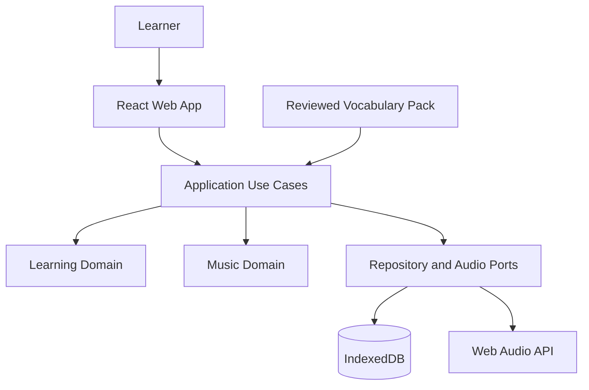

# Word Orchestra — System Architecture

> Status: proposed baseline for implementation  
> Product boundary: learning-led English practice; not a free-typing piano.

## 1. Architectural goals

The architecture must make the learning result independently measurable while keeping music responsive and enjoyable.

1. **Learning correctness:** Copying, recalling, listening, and contextual use are different evidence types. Copy events must never increase vocabulary mastery.
2. **Deterministic music:** The same character and preset map to the same pitch; the same vocabulary item and preset can reproduce the same motif.
3. **Low-latency interaction:** Keyboard-to-audio feedback is local and does not wait for a network request.
4. **Local-first privacy:** No account or backend is required for the MVP. Keyboard events are captured only by the focused practice input. Raw text outside the exercise is never observed or stored.
5. **Replaceable infrastructure:** UI, storage, and audio are adapters around framework-independent domain logic.
6. **Incremental delivery:** Each phase produces a runnable, testable product rather than a large unverified rewrite.

## 2. System context

The first release is a browser application. The browser owns input focus, audio playback, and local persistence. Vocabulary content is bundled and reviewed; there is no LLM-generated answer path in the MVP.



## 3. Layered architecture

Dependency direction is inward. Domain modules must not import React, browser APIs, IndexedDB, or audio implementation details.

| Layer | Responsibility | Allowed dependencies |
|---|---|---|
| Presentation | Screens, accessible controls, visual feedback | Application contracts |
| Application | Use-case orchestration, session lifecycle | Domain + ports |
| Domain | Vocabulary, attempts, mastery evidence, note mapping, composition rules | TypeScript only |
| Infrastructure | Web Audio, IndexedDB, bundled vocabulary, browser adapters | Domain + ports |
| Tooling | Build, lint, tests, CI | Source and test files |

### 3.1 Presentation

Feature-oriented screens:
- Practice: mode selection, prompt, focused answer field, feedback, next item.
- Session result: completed items, recall evidence, and replayable composition.
- Progress: separate language and typing indicators.
- Settings: sound, volume, and reduced-motion preferences.

UI components render state; they do not decide whether an attempt counts as mastery.

### 3.2 Application

Use cases coordinate domain decisions and persistence:
- `StartPracticeSession`
- `SubmitPracticeAnswer`
- `RecordPracticeInput`
- `CompletePracticeItem`
- `FinishPracticeSession`
- `LoadProgressSummary`

The application layer owns session state transitions and timestamps. It calls ports rather than constructing IndexedDB or AudioContext directly.

### 3.3 Domain modules

- **Vocabulary:** entries, senses, CEFR metadata, definitions, examples, content provenance.
- **Practice:** Copy/Recall exercise definitions, answer normalization, attempt outcomes, hint semantics.
- **Learning:** evidence by sense and direction; future scheduler integration. Copy is typing practice, not recall evidence.
- **Typing:** accuracy and timing aggregates, kept separate from vocabulary mastery.
- **Music:** letter-to-note mapping, deterministic motifs, phrase boundaries, composition events and playback intent.
- **Session:** ordered exercises, lifecycle, result summary.

### 3.4 Infrastructure adapters

- **Vocabulary adapter:** reviewed, versioned local seed pack.
- **Session repository:** IndexedDB with explicit schema version and repository interface.
- **Audio adapter:** Web Audio API implementation with lazy AudioContext creation, user-gesture unlock, voice limits, mute and graceful unsupported-browser fallback.
- **Clock and ID providers:** injectable for deterministic tests.

## 4. Runtime workflows

### 4.1 Copy

1. Application selects a vocabulary item and creates a Copy exercise.
2. UI shows the English target, pronunciation, and optional example.
3. Only the focused answer input receives key events.
4. Each accepted alphabetic character triggers a stable note mapping.
5. Submission compares normalized input with the target.
6. The attempt is saved as typing practice. It does not create a recall event or increase language mastery.
7. Completing the word creates a deterministic motif/accent for the session composition.

### 4.2 Recall

1. Application selects a vocabulary sense and creates a Recall exercise.
2. UI shows a Chinese meaning or reviewed English definition, not the answer.
3. Input and note playback behave as in Copy.
4. Submission is evaluated by the domain answer policy.
5. Correct/incorrect, hints, and answer reveal are recorded as attempt evidence.
6. Only a genuine no-answer-visible retrieval attempt can produce recall evidence. A revealed answer or copy-after-reveal remains practice, not successful recall.
7. The UI gives a supportive explanation and then advances.

### 4.3 Composition

1. Character input produces note events with relative offsets.
2. Word completion adds a deterministic word boundary/accent.
3. Punctuation and sentence boundaries add rests/cadence markers.
4. A session composition stores note events and preset metadata, not raw arbitrary text.
5. Replay uses the same event sequence and tempo metadata.

## 5. Music engine design

### 5.1 Stable mapping

- Use a fixed, documented mapping from normalized English letters to notes in a pentatonic scale.
- A character must not change pitch when the chord or session context changes.
- Mapping is versioned. A future mapping change must not silently reinterpret saved compositions.
- Use a deterministic seed derived from stable vocabulary/sense ID plus preset and mapping version for generated variations.

### 5.2 Audio boundaries

Define an `AudioEngine` port with operations equivalent to:
- unlock/resume after a user gesture;
- play one character note;
- play a word completion accent;
- play a composition;
- set mute/volume;
- dispose resources.

The Web Audio adapter must:
- lazily create one AudioContext;
- schedule notes against `AudioContext.currentTime`;
- use short attack/release envelopes to avoid clicks;
- cap simultaneous voices;
- stop or release scheduled voices on mute/dispose;
- avoid claiming real piano timbre when using synthesized oscillators;
- degrade to silent/visual feedback if Web Audio is unavailable.

No audio asset is bundled until its source and license are documented.

## 6. Data and persistence

### 6.1 Core records

- `VocabularyEntry`: lemma, sense ID, CEFR, part of speech, IPA, Chinese meaning, English definition, example, translation, source, license, review status.
- `PracticeAttempt`: session ID, item/sense ID, mode, result, hint count, replay count, timestamp, elapsed time (optional).
- `RecallEvidence`: item/sense ID, direction, grade, timestamp, whether answer was revealed, scheduler metadata (future).
- `TypingEvidence`: character count, error count, key-pair aggregates; never system-wide keyboard telemetry.
- `Composition`: mapping version, preset, tempo, ordered note events, creation time.
- `PracticeSession`: mode mix, ordered item IDs, start/end time, completion status.

### 6.2 Storage policy

- IndexedDB is the MVP persistence boundary.
- Repository interfaces isolate schema and transaction details from features.
- Schema changes require an explicit database version bump and migration test.
- Persist attempts and note events needed for history/replay; do not persist arbitrary raw input strings by default.
- Handle unavailable, blocked, or quota-exceeded storage with a visible non-persistent-session warning. Do not silently claim that progress was saved.
- Export/import and cloud sync are later phases, not hidden assumptions in the MVP.

## 7. State management

Use explicit state transitions for practice rather than several loosely related booleans.

```text
idle -> ready -> answering -> feedback -> ready
                                  |             |
                                  +-> complete <-+
```

The session is complete when all selected exercises have terminal outcomes or the learner explicitly ends it. Incorrect answers are recoverable and never destroy the composition.

Keep transient UI state local to a feature. Introduce a global state library only when cross-feature coordination demonstrates a real need.

## 8. Privacy and security

- No global `window` keydown listener for practice input.
- No system-level keyboard monitoring, browser extension permissions, or background capture.
- Ignore modifier shortcuts and composition events; do not treat IME composition as English character notes.
- Do not send practice answers, imported text, or vocabulary history to a server in the MVP.
- Do not store raw free-form text in composition records.
- Provide mute and pause controls; audio must not autoplay before a user gesture.
- Keep content provenance and license metadata for every vocabulary/audio asset.

## 9. Quality attributes and initial targets

| Attribute | Initial target | Verification |
|---|---|---|
| Input/audio responsiveness | Aim for p95 key-to-scheduled-note under 50 ms on supported desktop browsers | Browser performance measurement; report device/browser |
| Learning integrity | Copy attempts never create recall evidence | Domain tests |
| Determinism | Same letter + mapping version yields same note | Property/unit tests |
| Persistence | Completed session survives reload when storage is available | Repository and browser tests |
| Privacy | No listener outside the focused exercise input | Code review and browser tests |
| Accessibility | Keyboard-operable controls, visible focus, labelled input, reduced-motion support | Automated + manual checks |
| Reliability | Unsupported audio/storage degrades visibly without crashing practice | Adapter tests |

Targets are engineering goals, not claims of measured performance until tests are run on real devices.

## 10. Future extension points

- Listen and Context exercise types.
- FSRS-backed scheduler behind a `ReviewScheduler` port.
- Curated vocabulary import and provenance validation.
- Optional AI candidate generation behind an explicit opt-in and validation pipeline.
- Account/cloud sync only after local data model and export/import are stable.
- Separate Piano Typing product may reuse a low-level audio/key mapping package, but must not reuse Word Orchestra's learning scoring or scheduling policies.

## 11. Architecture decision summary

See [ADR-0001: Local-first modular web architecture](decisions/ADR-0001-local-first-web-architecture.md). Revisit decisions only with measured evidence or a concrete product requirement.
