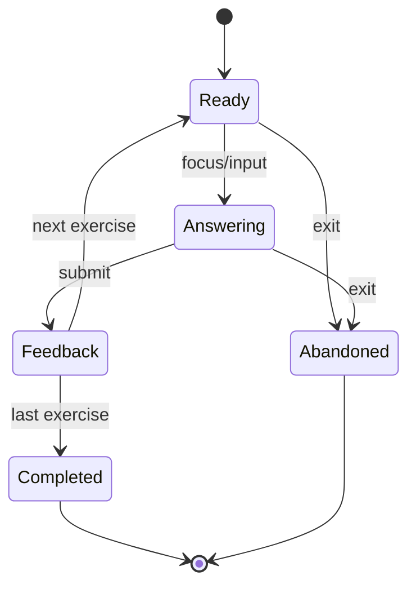

# Word Orchestra — Domain Model

## 1. Modeling principles

1. A spelling string is not the same thing as a vocabulary sense. A word may have multiple meanings and parts of speech.
2. Practice mode is part of the evidence. Copy, Recall, Listen, and Context cannot be collapsed into one correctness score.
3. Language mastery and typing skill are independent profiles.
4. A composition is an artistic artifact, not a proxy for learning quality.
5. Raw input is transient by default; persisted records should be purpose-limited.

## 2. Core aggregates

### VocabularyEntry

| Field | Meaning |
|---|---|
| id | Stable content ID |
| lemma | Canonical spelling |
| senses | One or more independently assessable meanings |
| cefr | Optional A1–C2 level |
| ipa | Pronunciation transcription and locale |
| partOfSpeech | Part of speech |
| examples | Reviewed example sentences and translations |
| provenance | Source, license, attribution, review status |

### VocabularySense

| Field | Meaning |
|---|---|
| id | Stable sense ID |
| definitionZh | Chinese meaning |
| definitionEn | Optional learner-facing English definition |
| acceptedAnswers | Explicit answer variants, never inferred loosely |
| tags | Topic and usage metadata |

### PracticeExercise

- `id`
- `sessionId`
- `vocabularySenseId`
- `mode: copy | recall | listen | context`
- `prompt`
- `createdAt`

Only Copy and Recall are in the first learning slice. Listen and Context remain reserved extension points.

### PracticeAttempt

- `id`
- `exerciseId`
- `mode`
- `outcome: correct | incorrect | revealed | skipped`
- `hintCount`
- `audioReplayCount`
- `submittedAt`
- `elapsedMs?`

Do not store the raw answer unless a future, explicit feature requires it and the user has consented.

### RecallEvidence

- `id`
- `vocabularySenseId`
- `direction: form | meaning | listening | context`
- `grade: again | hard | good | easy`
- `occurredAt`
- `answerWasVisible`

An event with `answerWasVisible = true` cannot count as successful retrieval. Copy mode does not emit RecallEvidence.

### TypingEvidence

- `id`
- `sessionId`
- `charactersExpected`
- `charactersCorrect`
- `errorCount`
- `durationMs`
- optional aggregate key-pair timing

Do not collect operating-system-wide keystrokes or infer physical key pressure from ordinary keyboard events.

### Composition

- `id`
- `sessionId`
- `mappingVersion`
- `presetId`
- `tempo`
- `events: NoteEvent[]`
- `createdAt`

A `NoteEvent` contains a note/pitch, relative start time, duration, velocity proxy (only if explicitly defined as a software parameter), and event kind. It must not contain the original typed text.

### PracticeSession

- `id`
- `startedAt`
- `completedAt?`
- `status: active | completed | abandoned`
- `exerciseIds`
- `attemptIds`
- `compositionId?`

## 3. Evidence rules

| Activity | Typing evidence | Language recall evidence | Mastery impact |
|---|---:|---:|---|
| Copy correctly | Yes | No | None |
| Copy incorrectly | Yes | No | None |
| Recall correctly without reveal | Yes | Yes | Eligible for scheduler |
| Recall incorrect | Yes | Yes | Review signal; not mastery gain |
| Recall after answer reveal | Yes | No successful recall | None |
| Listen correctly | Yes | Listening evidence | P1 |
| Context correctly | Yes | Context evidence | P1 |

A session score may summarize activity, but it must not be called mastery.

## 4. Practice state machine

The state machine should preserve recoverability: wrong answers show feedback and allow a retry or next item without deleting note events already created.

## 5. Invariants

- Every attempt references an existing exercise and session.
- Every exercise references a known vocabulary sense.
- Copy attempts never create recall evidence.
- Answer reveal prevents that attempt from being counted as successful retrieval.
- A sense's form and meaning evidence are stored separately.
- A composition references a mapping version and contains ordered note events.
- Composition data never requires raw typed text to replay.
- Deleting a session must also delete its attempts, evidence, and composition references transactionally.
